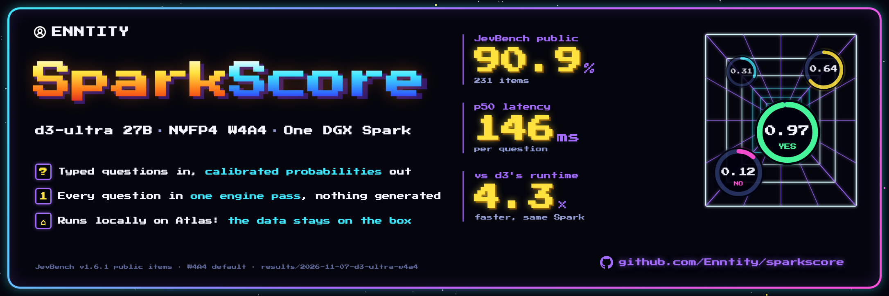
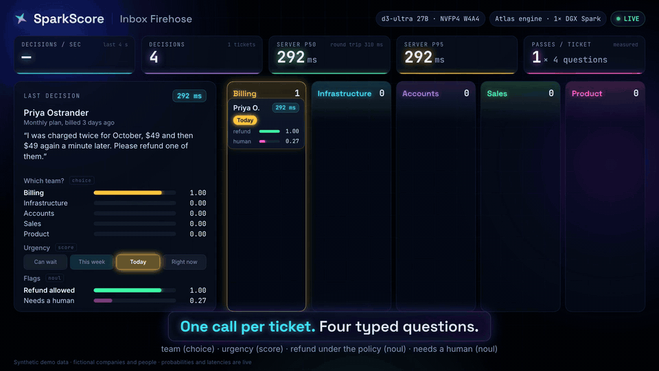
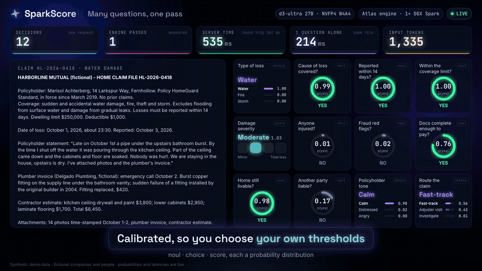

<!-- SPDX-License-Identifier: AGPL-3.0-only -->
<p align="center"></p>

# SparkScore

**Typed, calibrated decisions on one NVIDIA DGX Spark.** Send a state and a
set of typed questions. Each question is yes/no (`noul`), one of named options
(`choice`) or an ordinal level (`score`). You get back one probability
distribution per question, from one forward pass of the engine. Nothing is
generated, so there is nothing to parse and nothing to hallucinate.

SparkScore serves [d3-ultra](https://huggingface.co/vllm-sr/d3-ultra) (27B, by
the vLLM Semantic Router team) quantized to NVFP4, on the
[Atlas](https://github.com/Atlas-Inf/atlas) inference engine. The API has the
shape of TypeSafe's Jev decision API, and it accepts the model name
`jev-latest`, so a Jev client needs only a new base URL. It runs on your own hardware, so the data you score stays
on the box.

<p align="center"></p>

## Results on one DGX Spark

JevBench v1.6.1, the 231 public items, latency per question measured at the
harness:

| Engine | Accuracy | Brier | p50 | p95 |
|---|---:|---:|---:|---:|
| **SparkScore, d3-ultra NVFP4 (W4A4, the default)** | 90.9% | 0.118 | **146 ms** | **1.05 s** |
| SparkScore, d3-ultra NVFP4 (W4A8, `--precision w4a8`) | **92.2%** | **0.115** | 158 ms | 1.31 s |
| d3-ultra, d3's own BF16 runtime, same Spark | 91.3% | 0.117 | 633 ms | 3.07 s |
| KnowLine-35B-A3B NVFP4, SparkScore | 87.4% | 0.165 | 176 ms | 1.21 s |

- **Same model, 4.3× faster.** d3's own runtime scores the same items within
  one point at 633 ms. SparkScore reads the state and every question in one
  pass and runs the matrix multiplies on the Spark's FP4 tensor cores.
- **W4A4 or W4A8.** On JevBench, 4 items are right only under W4A8 and 1 only
  under W4A4 (exact McNemar p = 0.38). Across 2,966 kev-suite rows W4A4 gets 3
  more right, and on a 1,000-row Decision Index sample it scores 0.756 against
  0.749. W4A4 is the default because it is faster and no worse on the larger
  suites.
- **Many questions cost little more than one.** Twelve questions about one
  1,300-token claim file take about 520 ms; one question about the same file
  takes about 210 ms.
- **Engine.** One score pass over 288 rows (the JevBench median) takes 139 ms,
  against a hardware limit near 75 ms. Long passes run at about 130 TFLOPS.

Every number has receipts:
[results/2026-11-07-d3-ultra-w4a4](results/2026-11-07-d3-ultra-w4a4/RESULT.md)
(the default),
[final-latency](results/2026-11-07-d3-ultra-final-latency/RESULT.md) and
[final-accuracy](results/2026-11-07-d3-ultra-final-accuracy/RESULT.md) (W4A8),
and [activation-formats](results/2026-11-07-activation-formats/RESULT.md) (why
these 4-bit formats). [docs/REPRODUCE.md](docs/REPRODUCE.md) reruns them.

For public context: on the [Jev Decision Index](https://huggingface.co/datasets/multimodalart/decision-index-leaderboard)
text board d3-ultra ranks 7th (full score 70.18, a submission by its authors).
That is the model's placement, not a SparkScore measurement.

## Quickstart

You need one DGX Spark (GB10, DGX OS with Docker and the NVIDIA Container
Toolkit), about 150 GB of free disk and an internet connection for the first
run.

```bash
git clone https://github.com/Enntity/sparkscore.git
cd sparkscore
./start.sh
```

The first run takes about an hour, and later runs start in about a minute:

1. **Build.** It builds the image: Atlas from source at the commit pinned in
   [install/atlas-source.json](install/atlas-source.json), plus the harness
   (20–40 minutes).
2. **Download and convert.** It downloads d3-ultra and the ModelOpt format
   reference at pinned revisions (about 74 GB, both Apache-2.0, no login) and
   converts d3-ultra to NVFP4. It then checks the result against the reference
   build's checksums byte for byte.
3. **Serve and smoke-test.** It serves on `127.0.0.1:8015` and sends one
   smoke request.

Then ask it something:

```bash
curl -s http://127.0.0.1:8015/v1/systemone -H 'content-type: application/json' -d '{
  "model": "sparkscore-d3",
  "state": "Refund policy: refunds within 30 days; annual plans are refunded pro rata.\n\nTicket from Mina (annual plan, bought 5 months ago): \"We barely use it anymore. I would like a refund for the rest of the year.\"",
  "questions": {
    "team":    {"type": "choice", "instructions": "Which team should handle this?",
                "criteria": {"billing": "Billing", "infrastructure": "Infrastructure", "sales": "Sales"}},
    "urgency": {"type": "score", "instructions": "How urgent is this?",
                "criteria": ["Can wait", "This week", "Today", "Right now"]},
    "refund":  {"type": "noul", "instructions": "Is a refund allowed under the policy?"}
  }
}'
```

```json
{
  "answers": {
    "team":    {"type": "choice", "choice": "billing",
                "probabilities": {"billing": 0.9943, "infrastructure": 0.0001, "sales": 0.0055}},
    "urgency": {"type": "score", "score": 0.4831, "confidence": 0.5169,
                "probabilities": {"0": 0.5414, "1": 0.4386, "2": 0.0155, "3": 0.0045}},
    "refund":  {"type": "noul", "noul": 0.9542}
  }
}
```

(Abridged. The full response shape is in [docs/API.md](docs/API.md).) Each
response carries a `Server-Timing` header with the time spent rendering,
in the engine and in total. `X-SparkScore-Passes: 1` says the whole request
went to the engine as one score request.

### Other commands

| Command | What it does |
|---|---|
| `./start.sh stop`, `status`, `logs` | Manage the server. |
| `./start.sh --precision w4a8` | Serve the W4A8 alternative. |
| `BIND=0.0.0.0 ./start.sh serve` | Serve on your network. Set `SPARKSCORE_API_KEY` to require a bearer key. |
| `python3 demo/serve.py` | Open the live demo at http://127.0.0.1:8780. |

The demo has four scenes:
- inbox triage;
- a guardrail that checks an agent's tool calls against a written policy;
- live review of a reply as you type;
- twelve decisions about an insurance claim file in one pass.

All their data is fictional, and all timings are live.

<p align="center"></p>

## How it works

A decision request is a long state followed by short questions. Most servers
run each question as its own prompt, so the state is read once per question.
SparkScore sends Atlas one **score pass**:

- **Rows.** The state's rows come first, followed by every question's branch.
- **State.** The Gated DeltaNet layers fork the state's recurrent state into
  each branch.
- **Attention.** The attention layers share the state's KV.
- **Prefix-bidirectional attention.** Within the state block, attention is
  bidirectional, which is how d3-ultra was trained.
- **Head.** The head computes logits only at each branch's option tokens.

So the weights are read once per request, however many questions it has, and
concurrent requests merge into one pass.

The dense 27B prefill kernels behind it use the GB10's FP4 tensor cores
directly (`mma.sync kind::mxf4nvf4`). NVFP4 weights meet NVFP4 tokens for the
MLP and attention, and FP8 meets FP8 for the Gated DeltaNet projections. One
CTA computes each output in a fixed order, so a request scores the same alone
or merged with others.

The details, the cost model and the roofline are in
[docs/ENGINE.md](docs/ENGINE.md).

## Limitations

- **Hardware.** One DGX Spark (GB10) only. The kernels are written for its
  tensor cores and memory system.
- **Input.** Text only. d3-ultra's image and box questions are not served.
- **Length.** A question's prompt may be up to 32,768 tokens, a request up to
  65,536 tokens and 256 questions. Longer requests are refused, not
  truncated. Atlas splits a request with several questions into more than one
  pass when it doesn't fit one (about 38,000 rows).
- **Latency under load.** Latency grows with load. 16 concurrent requests
  finish in about 3 s, against 0.2 s for one. The engine merges requests into
  shared passes, but one Spark has one GPU.
- **Calibration.** The readout temperatures are fitted on held-out kev data.
  For your own task, check calibration on your own labels before choosing
  thresholds (`tools/sparkscore/calibrate.py`).
- **Precision.** W4A4 shifts d3-ultra's probabilities slightly against its
  BF16 runtime: mean KL 0.015 on a 49-question reference set, with the same
  answer on 47 of 49. If you need the closest match to BF16, use
  `--precision w4a8`.

## The engine

The score path and kernels are proposed upstream as an Atlas pull request
([Atlas-Inf/atlas#331](https://github.com/Atlas-Inf/atlas/pull/331)). Until it merges, SparkScore builds Atlas from the
[`Enntity/atlas`](https://github.com/Enntity/atlas) branch named in
[install/atlas-source.json](install/atlas-source.json). Once it merges,
`install/repin.sh` moves the pin to Atlas-Inf, and nothing else changes.

## Repository

| Path | Contents |
|---|---|
| `start.sh`, `install/` | Install, image, conversion, entry point and smoke test. |
| `tools/sparkscore/` | The harness: the Jev-compatible server, prompt templates, answer math, calibration and benchmark runners. |
| `tools/nvfp4_convert.py` | A bit-exact reproduction of ModelOpt's NVFP4/FP8 weight quantization. |
| `demo/` | The live demo and its recorder. |
| `results/` | Dated results, each with raw receipts and `SHA256SUMS`. |
| `docs/` | API, engine, reproduction and competitor notes. |

## Credits and license

- **Model.** d3-ultra is by the vLLM Semantic Router team (Apache-2.0). Its
  NVFP4 format follows NVIDIA ModelOpt through the
  `a2genesis/Qwen3.8-27B-NVFP4` reference (Apache-2.0).
- **Engine.** Atlas is AGPL-3.0.
- **API shape.** It follows TypeSafe's Jev API.
- **Benchmarks.** JevBench, the Decision Index and kev-suites are by their
  respective authors; see [docs/COMPETITORS.md](docs/COMPETITORS.md).

SparkScore's code is AGPL-3.0-only ([LICENSE](LICENSE), [NOTICE](NOTICE)). If
you serve it to others over a network, the AGPL asks you to offer them the
source of your version. The converted weights you produce stay under the
model's Apache-2.0 license.
